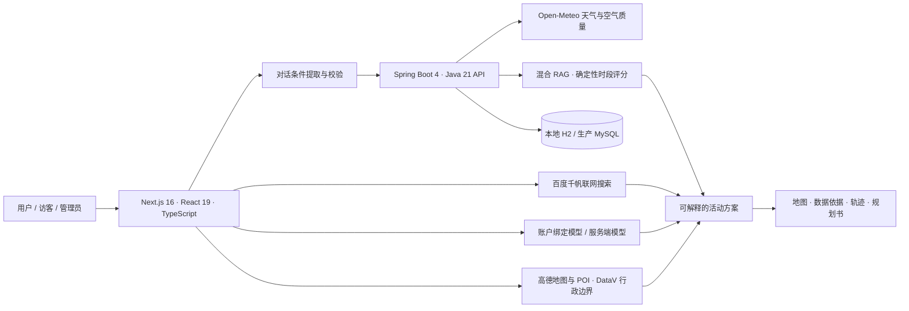

# 行知 · AI 活动与旅行规划

通过自然语言完成活动需求确认、真实环境数据查询、地图展示与规划书生成的 Web 应用。

- **公开仓库**：<https://github.com/liangjie798/xingzhi-ai-planner>
- **在线演示**：<https://lht574.cn/XingZhi>（可在登录页选择访客体验）
- **团队**：刘瀚艇（队长）、石晗喆、郑少卓

## 项目介绍

用户可以直接说“规划杭州未来三天的旅游路线”，系统追问尚未确认的人数、人群等条件。继续回答“七个大学生”后，会结合真实天气、空气质量、候选地点和联网资料生成三日行程。用户还可以修改日期、时长和人群，系统据此重新计算。

支持旅游规划、校园运动会、体育课、社区活动、户外训练、研学活动六种场景。条件通过对话逐步确认；分析台、环境地图、执行方案分为独立视图。

### 主要功能

| 模块 | 已实现内容 |
| --- | --- |
| 对话规划 | 多轮条件记忆、中文人数识别、日期范围确认、缺失条件追问 |
| 环境地图 | 默认全国视图，34 个省级代表地点真实采样；连续色带按行政边界裁切，指定城市后切换到当地地图 |
| 环境分析 | 气温、湿度、降雨、US AQI、热风险与候选时段比较；独立逐小时页面 |
| 联网搜索 | 百度千帆搜索 API 检索全网攻略及收录的小红书、抖音内容，保留链接与检索状态；可选 Tavily |
| 旅游路线 | 景点与美食编排、地点图片、按日行程、推荐理由、地图站点与连线 |
| 活动方案 | 按日、按时间组织准备、正式活动、休息和离场，包含岗位建议与备用预案 |
| 规划书 | 页面阅读、图文旅行方案、Word / Markdown 下载及浏览器打印为 PDF |
| Agent 轨迹 | 展示实际工具步骤、耗时、模型结果或兜底原因；不模拟不存在的工具调用 |
| 账户管理 | 用户、访客、管理员入口，个人记录、账户绑定模型配置、注册和搜索统计 |

## 技术架构



依赖版本以 [frontend/package-lock.json](frontend/package-lock.json) 和 [backend/pom.xml](backend/pom.xml) 为准。主要技术为 Next.js 16.4、React 19、GSAP、Spring Boot 4.1、Java 21、Spring Security、Spring Data JPA。

模型负责需求理解、路线编排和文字解释；环境数值、风险评分及引用校验由程序产生。模型未配置、超时或结果校验失败时，会说明具体原因并提供可解释的规则方案。百度搜索密钥与大模型密钥是两种独立配置。

## 目录结构

```text
.
├── frontend/                 Next.js 页面、服务端路由、组件、规划逻辑
│   ├── src/app/              分析台、地图、方案、登录、管理及 API 路由
│   ├── src/components/       地图、对话、规划书与工具轨迹组件
│   ├── src/lib/              条件校验、搜索、模型、地点、文档生成
│   └── tests/                Node.js 测试
├── backend/                  Spring Boot 后端
│   ├── src/main/java/        controller / service / dao / dto / entity 等分层
│   ├── src/main/resources/   应用配置、权威资料语料
│   └── src/test/             服务与检索测试
├── deploy/                   Nginx、systemd、原生部署参考
├── docs/                     环境、功能边界和参赛材料说明
├── scripts/                  发布前历史检查
├── .github/workflows/        自动化质量检查
├── .env.example              Docker 部署变量模板
└── docker-compose.yml        MySQL、后端、前端、Nginx
```

## 安装与本地运行

### 1. 准备环境

- Git、Node.js **22** 与 npm。
- JDK **21**，正确设置 `JAVA_HOME`。仓库包含 Maven Wrapper，无需单独安装 Maven。
- 本地开发默认使用内存 H2，不要求安装 MySQL。重启后本地 H2 数据会清空。
- 环境数据、地图、联网搜索和模型接口需要网络访问。

```bash
git clone https://github.com/liangjie798/xingzhi-ai-planner.git
cd xingzhi-ai-planner
```

### 2. 启动后端

Linux / macOS：

```bash
cd backend
cp .env.example .env
# 按需编辑 .env；可选管理员密码应自行设置。
set -a
. ./.env
set +a
bash ./mvnw spring-boot:run
```

Windows PowerShell：

```powershell
cd backend
# 确保 JAVA_HOME 指向本机的 JDK 21。可选管理员配置：
$env:ADMIN_USERNAME = 'admin'
$env:ADMIN_PASSWORD = Read-Host '设置本地管理员密码'
# 与前端 .env.local 中的 MODEL_CONFIG_SECRET 保持一致。
$env:MODEL_CONFIG_SECRET = '替换为自行生成的随机字符串'
./mvnw.cmd spring-boot:run
```

后端默认端口 `8080`，健康检查：`http://localhost:8080/actuator/health`。Spring Boot 不会自动加载 `.env`；Windows 请用环境变量传入，Linux 示例已显式导入。

### 3. 启动前端

在另一个终端中：

```bash
cd frontend
cp .env.example .env.local
# Windows 可用 Copy-Item .env.example .env.local
npm ci
npm run dev
```

访问 **http://localhost:3000**。开发服务器会将 `/api/*` 转发至本地后端。请将 `.env.local` 中的 `MODEL_CONFIG_SECRET` 设置为与后端相同的值。

高德地图需要有效的 Web JSAPI Key 和安全配置；未配置时地图会提示不可用，不能用于完整地图演示。联网搜索和模型均为可选项，未配置时界面会说明功能限制。`npm run build` 会检查高德 Key，空值会阻止生产构建。

### 4. 评审体验路径

1. 登录页选择“访客”，进入分析台；也可注册用户。
2. 输入“规划杭州未来三天的旅游路线”。
3. 根据追问回复“七个大学生”，确认条件后生成规划。
4. 打开环境地图、行程方案、数据与证据、Agent 轨迹。
5. 下载 Word 或 Markdown 规划书，或使用打印功能保存 PDF。

管理员和超级管理员通过环境变量初始化，仓库不提供生产管理员密码。具体变量及权限见 [环境配置说明](docs/ENVIRONMENT.md)。

## 环境配置与依赖

| 用途 | 模板或清单 |
| --- | --- |
| 前端本地配置 | [frontend/.env.example](frontend/.env.example) |
| 后端本地配置 | [backend/.env.example](backend/.env.example) |
| Docker 部署配置 | [.env.example](.env.example) |
| 变量说明及故障排查 | [docs/ENVIRONMENT.md](docs/ENVIRONMENT.md) |
| 前端依赖与锁定版本 | [package.json](frontend/package.json)、[package-lock.json](frontend/package-lock.json) |
| 后端依赖与 Java 版本 | [pom.xml](backend/pom.xml)、[Maven Wrapper](backend/.mvn/wrapper/maven-wrapper.properties) |

模型设置页可将配置绑定到用户账户，重新登录不需要重复录入。密钥不进入下载的规划书或 Git 仓库。

## 构建与测试

```bash
cd frontend
npm run lint
node --experimental-strip-types --test tests/*.test.mjs
npm run build

cd ../backend
bash ./mvnw test
# Windows 使用 ./mvnw.cmd test

cd ..
node scripts/check-publish.mjs
```

`.github/workflows/ci.yml` 在推送及 Pull Request 时运行前端检查、测试和构建，以及后端测试。CI 的地图构建占位值仅用于编译，不用于真实地图请求。

## 部署

```bash
cp .env.example .env
# 必须替换数据库密码、管理员密码、MODEL_CONFIG_SECRET，并配置高德 Key。
docker compose --env-file .env config --quiet
docker compose up -d --build
docker compose ps
```

默认通过 Nginx 的 `80` 端口访问。公网部署应配置 HTTPS，并相应设置 `SESSION_COOKIE_SECURE=true` 与允许的前端来源。不要直接在运行生产服务的小内存服务器上执行整套依赖安装和构建；优先在开发机或 CI 构建镜像后部署。

`deploy/` 中保留 Ubuntu 原生部署脚本和当前站点的配置参考，其中域名、目录、资源参数应按自己的环境修改。不要在已有数据库上未经检查直接运行初始化脚本。服务器私有环境文件、用户数据及登录态均不随仓库发布。

## 关键接口

| 接口 | 说明 |
| --- | --- |
| `POST /conversation-planner` | 多轮需求提取与确认 |
| `GET /national-environment` | 全国代表地点环境采样 |
| `GET /region-data/{adcode}` | 行政区边界 |
| `POST /social-research` | 百度搜索与引用资料 |
| `POST /tourism-planner` | 旅游路线编排及校验 |
| `POST /model-gateway` | 账户绑定模型调用 |
| `GET /api/v1/cities/environment` | 按坐标读取环境数据 |
| `GET /api/v1/cities/hourly` | 逐小时环境预报 |
| `POST /api/v1/decisions/analyze` | 活动风险评分与方案 |
| `POST /api/v2/agent/stream` | 后端 Agent 工具 SSE 轨迹 |

## 数据与使用边界

- 天气和空气质量来自 Open-Meteo 模型网格数据，不是逐点地面实测。对话默认规划窗口为今天起七天，出行前需复核预警、预约及营业情况。
- 全国颜色来自 34 个省级代表地点的采样插值，不能视为省域平均值或每个地点的真实数值；缺测区域不着色。详见 [全国地图说明](docs/national-environment.md)。
- 空气质量明确使用 **US AQI**。风险评分是应用规则指标，不是行政预警或医疗结论。
- 百度搜索结果受搜索引擎收录范围影响，不等于抖音或小红书全站数据、实时热榜；原文摘要未逐篇验证。详见 [联网搜索说明](docs/social-research.md)。
- 地图路线连线表示行程顺序，不是道路导航；图片及 POI 信息需按来源与平台规则使用。
- MediaCrawler 曾做过学习研究验证，已回退；当前代码不包含该采集服务，也不依赖本机扫码浏览器。
- 第三方包遵循各自许可证；项目架构参考及原创性说明见 [GitHub 调研记录](docs/GITHUB_RESEARCH.md)。公开托管不代表另行授予第三方素材或服务的数据使用权。

## 团队信息

| 姓名 | 团队身份 |
| --- | --- |
| 刘瀚艇 | 队长 |
| 石晗喆 | 队员 |
| 郑少卓 | 队员 |

具体分工以团队提交的参赛材料为准；本仓库不虚构贡献比例或成员提交记录。

## Git 历史与参赛要求

保留从原型、地图、Agent、登录、规划书到当前版本的完整提交历史，不通过重新初始化仓库或合并成单次提交替代开发记录。项目早期名称为“适候”，因此历史目录、包名和提交中仍保留 `shihou`。

[参赛交付清单](docs/SUBMISSION.md) 对照公开访问、代码结构、README、Git 历史及环境配置逐项列出入口。可通过 GitHub Issues 提交问题。
