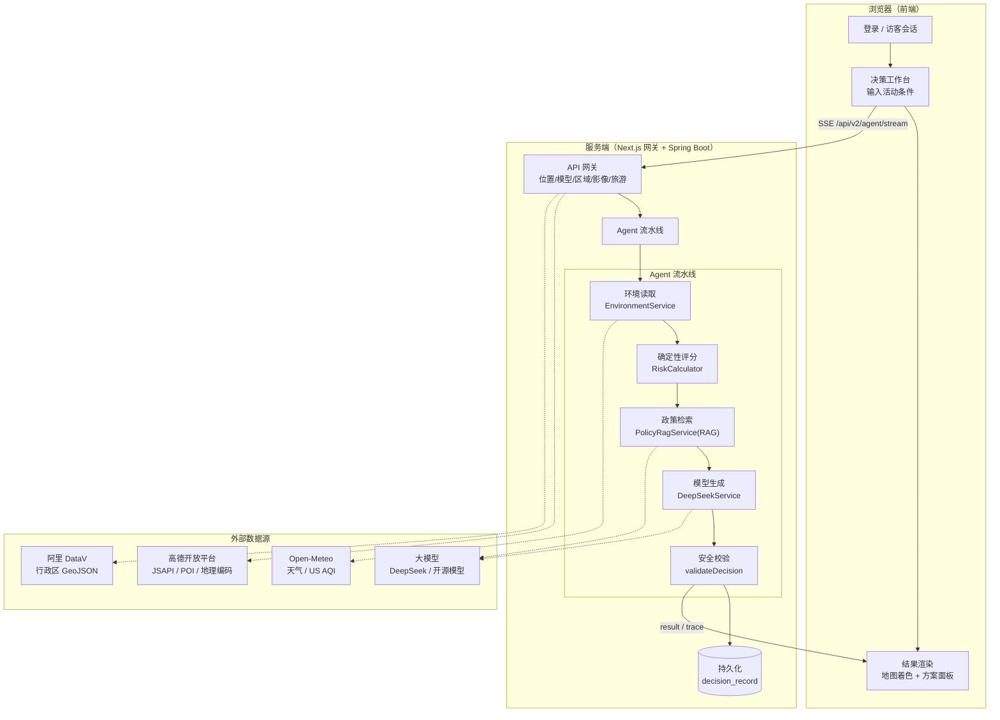
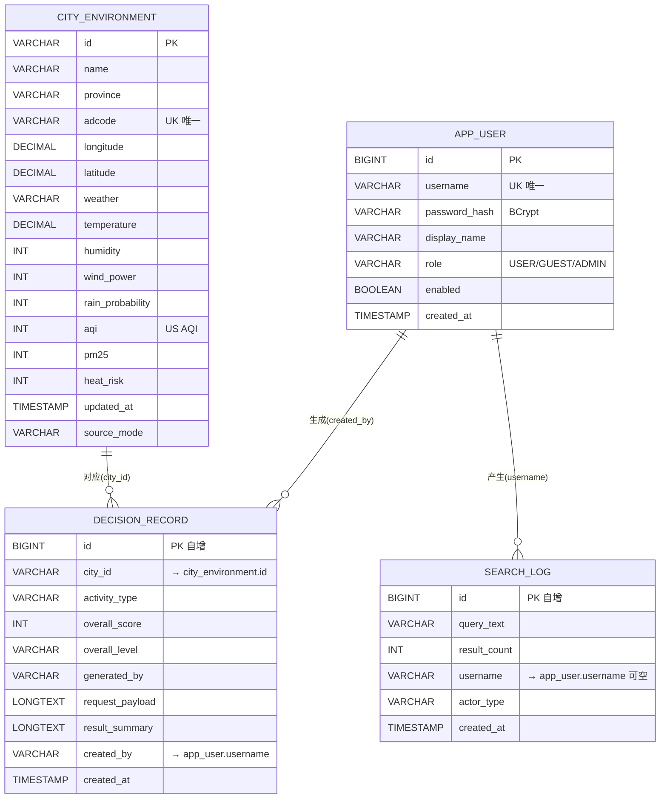

# 适候 · AI 户外活动环境决策平台 — 开发文档

> 版本：0.1.0 ｜ 更新日期：2026-10-20 ｜ 仓库根目录：`amap-jsapi/`

---

## 1. 项目概述

「适候」是一套面向学校、社区和活动组织者的户外活动环境决策 Web 平台。用户选择城市（支持精确到区县）、时间、活动强度与参与人群后，系统读取真实逐小时天气与空气质量预报，通过**确定性安全算法**为候选时段评分，并结合**大模型（AI Agent）**生成可解释的行动建议、依据与工具轨迹。平台额外提供逐小时数据页、旅游人群路线规划（地图绘制路线）、场地影像审查、账户体系与管理后台。

核心设计原则：

1. **模型只能写文字，不能改数值**——时段评分由 `RiskCalculator` 确定性计算，大模型仅生成解释性文案，并经 `validateDecision` 二次校验，校验失败自动降级为规则方案。
2. **数据可追溯**——每条建议都对应可核验的政策依据（内置 52 条权威语料）与原始环境数据，US AQI 与国产 AQI 的区别在界面明确标注。
3. **多层降级**——大模型不可用时自动回退到免密钥开源模型；开源模型仍不可用则回退到规则引擎；高德密钥缺失时地图降级为坐标视图。任何单项外部依赖故障都不影响核心决策。
4. **身份与数据边界**——用户/访客/管理员三种角色权限隔离，密码 BCrypt 加密、服务端会话、CSRF 防护。

---

## 2. 技术栈

### 2.1 前端（`frontend/`）

| 类别 | 技术 | 说明 |
| --- | --- | --- |
| 框架 | Next.js 16.4.2（App Router） | Turbopack 构建，`output: "standalone"` 独立部署 |
| UI 库 | React 19.3 | 函数组件 + Hooks |
| 语言 | TypeScript 5 | 全量类型 |
| 样式 | Tailwind CSS 4 + @radix-ui/themes | `@tailwindcss/turbopack` 规则接入 |
| 图标 | @phosphor-icons/react | 统一图标体系 |
| 地图 | @amap/amap-jsapi-loader 2.0 | 高德 JS API（3D、Polygon、CircleMarker、Polyline） |
| 校验 | zod 4 | 表单/请求结构校验 |

### 2.2 后端（`backend/`）

| 类别 | 技术 | 说明 |
| --- | --- | --- |
| 框架 | Spring Boot 4.1.1 | `spring-boot-starter-webmvc` |
| 语言 | Java 21 | 使用 record、switch 表达式等新特性 |
| 数据访问 | Spring Data JPA | Hibernate ORM |
| 数据库 | H2（开发）/ MySQL 8.4（生产） | 生产 `ddl-auto: update` |
| 安全 | Spring Security | 会话认证 + BCrypt(12) + CSRF Cookie |
| 校验 | Bean Validation（jakarta） | `@Valid` 请求校验 |
| JSON | Jackson 3（`tools.jackson`） | Spring Boot 4 默认 |
| 观测 | Spring Actuator | `/actuator/health`、`/actuator/info` |
| 构建 | Maven | `spring-boot-maven-plugin` |

### 2.3 外部数据源

| 数据源 | 用途 | 关键接口 |
| --- | --- | --- |
| Open-Meteo | 逐小时天气、降雨、体感温度 | `api.open-meteo.com/v1/forecast` |
| Open-Meteo Air Quality | US AQI、PM2.5 | `air-quality-api.open-meteo.com/v1/air-quality` |
| 高德开放平台 | 地图 JS API、地理编码、POI 检索 | JSAPI 2.0 + `restapi.amap.com/v3` |
| 阿里云 DataV | 行政区边界 GeoJSON | `geo.datav.aliyun.com/areas_v3/bound/` |
| 大模型 | AI Agent 文案生成 | DeepSeek / 硅基流动(Qwen) / Pollinations(开源免key) |

---

## 3. 目录结构

```text
amap-jsapi/
├─ frontend/                          Next.js 16 + React 19 + TypeScript
│  ├─ src/app/
│  │  ├─ page.tsx                     # 根路径 → redirect /login
│  │  ├─ layout.tsx                   # 根布局（Radix Theme + metadata）
│  │  ├─ globals.css                  # 全局样式（含暗/亮自适应变量）
│  │  ├─ login/page.tsx               # 登录/注册/访客/管理员入口
│  │  ├─ welcome/page.tsx             # 启动引导页
│  │  ├─ dashboard/page.tsx           # 决策工作台（核心）
│  │  ├─ hourly/page.tsx              # 逐小时环境数据页
│  │  ├─ account/page.tsx             # 个人账户 · 决策历史
│  │  ├─ admin/page.tsx               # 管理台 · 用户/搜索/概览
│  │  ├─ settings/page.tsx            # AI 模型配置页
│  │  ├─ location-gateway/route.ts    # 高德位置服务代理（search/geocode/reverse）
│  │  ├─ model-gateway/route.ts       # 大模型调用代理（支持图片）
│  │  ├─ region-data/[adcode]/route.ts# 行政区边界 GeoJSON 代理
│  │  ├─ site-analysis/route.ts       # 场地影像分析（视觉模型）
│  │  └─ tourism-planner/route.ts     # 旅游路线编排
│  ├─ src/components/
│  │  ├─ decision-dashboard.tsx       # 工作台主组件（SSE 流式、搜索、旅游模式）
│  │  ├─ decision-result-panel.tsx    # 决策结果面板（方案/证据/轨迹）
│  │  ├─ environment-map.tsx          # 中央地图（边界裁切、网格着色、路线绘制）
│  │  ├─ venue-photo-analysis.tsx     # 场地照片上传与视觉分析
│  │  └─ account-badge.tsx            # 顶栏账户徽章
│  └─ src/lib/
│     ├─ types.ts                     # 全局类型定义
│     ├─ cities.ts                    # 9 城市常量 + 本地存储
│     ├─ auth.ts                      # 认证/账户/管理 API 客户端
│     ├─ amap-lbs.ts                  # 高德位置服务客户端
│     ├─ comfort.ts                   # 适宜度计算
│     ├─ poi.ts                       # 内置城市 POI 库
│     ├─ tourism.ts                   # 旅游路线客户端
│     ├─ model-config.ts              # 模型配置（localStorage）
│     └─ llm-server.ts                # 服务端大模型调用链
│
├─ backend/                           Spring Boot 4.1 + Java 21 + Maven
│  ├─ db/db.sql                       # 数据库结构参考（MySQL）
│  └─ src/main/
│     ├─ java/com/shihou/
│     │  ├─ annotation/Traceable.java # 追踪注解
│     │  ├─ config/                   # Security、Web、DeepSeek、Admin 引导
│     │  ├─ controller/               # HTTP 接口层（8 个 Controller）
│     │  ├─ dao/                      # JPA Repository
│     │  ├─ dto/                      # 请求/响应结构
│     │  ├─ entity/                   # 4 个数据库实体
│     │  ├─ interceptor/              # 请求追踪（X-Trace-Id）
│     │  ├─ service/                  # 环境、决策、RAG、模型服务
│     │  ├─ utils/RiskCalculator.java # 确定性风险计算
│     │  └─ ShihouBackendApplication.java
│     └─ resources/
│        ├─ application.yml           # 本地（H2）配置
│        ├─ application-prod.yml      # 生产（MySQL）配置
│        └─ knowledge/policy-corpus.json # 52 条政策依据语料
│
├─ deploy/
│  ├─ nginx.conf                      # 统一入口反向代理
│  └─ 阿里云部署与域名绑定说明.md      # 部署手册
├─ docker-compose.yml                 # MySQL + 后端 + 前端 + Nginx
└─ .env.example                       # 环境变量模板
```

---

## 4. 核心模块说明

### 4.1 前端核心模块

#### 4.1.1 `decision-dashboard.tsx`（决策工作台，~625 行）
平台主界面。三栏布局：左侧活动条件表单、中间地图工作台、右侧决策面板。
- **城市搜索**：调用 `/location-gateway`（高德地理编码 + 行政区查询），支持精确到区县；选中后以自定义坐标请求环境数据。
- **SSE 流式决策**：通过 `EventSource`/流式 fetch 读取 `/api/v2/agent/stream`，实时回显 `trace` 工具事件，最终接收 `result`。
- **旅游模式**：当人群选择「外来旅游人群」时，切换为路线规划，调用 `/tourism-planner` 并在地图绘制路线。
- **地图数据装配**：3×3 网格采样逐小时预报 → 传给地图着色；行政区边界 → `regionBounds`。

#### 4.1.2 `environment-map.tsx`（中央地图，~530 行）
- 使用高德 JS API 2.0 渲染 3D 地图。
- **分层着色**：将稀疏气象采样值逐像素插值，并按真实行政区 GeoJSON（`/region-data/[adcode]`）逐像素裁切，用 `AMap.Polygon` 绘制边界，`AMap.CircleMarker`/插值图层表示数据深浅，左下角附渐变图例。
- **旅游路线**：`AMap.Polyline` 折线 + 编号站点标注，自动 `setFitView`。
- **降级**：无高德密钥时切换为坐标画布（CSS 渲染网格点 + SVG 路线）。

#### 4.1.3 其它组件
- `decision-result-panel.tsx`：决策结果的「方案 / 证据 / 轨迹」三标签面板。
- `venue-photo-analysis.tsx`：上传场地照片 → `/site-analysis` 视觉审查（遮阴/排水/地面/疏散/人群）。
- `account-badge.tsx`：顶栏显示当前登录身份。

### 4.2 后端核心模块

#### 4.2.1 `DecisionService`（决策编排，核心）
实现「有界 Agent」工作流，六个确定性步骤 + 模型增强：

1. **plan**：`DeepSeekService.plan()` 通过 Function Calling 让模型选择工具（配置密钥时），否则使用受控安全计划。
2. **environment**：`EnvironmentService` 读取日期范围内的真实逐小时预报。
3. **score**：`RiskCalculator.calculateSlots()` 确定性评分（模型无权修改）。
4. **rag**：`PolicyRagService.retrieve()` 检索政策依据。
5. **compare / contingency**：比较时段、生成应急预案。
6. **synthesis**：`DeepSeekService.synthesize()` 生成结构化方案（仅文字）。
7. **verify**：`validateDecision()` 校验数值一致性、引用合法性、天气风险措辞，失败回退。

#### 4.2.2 `EnvironmentService`（环境数据）
- 内置 9 个城市定义，支持自定义坐标（区县）。
- 并发调用 Open-Meteo 天气 + 空气质量接口，10 分钟内存缓存（`ConcurrentHashMap`）。
- 计算热风险（体感温度 + 湿度 + 低温修正）、蒲福风级、天气中文名。
- 将快照写入 `city_environment` 表。

#### 4.2.3 `RiskCalculator`（确定性评分）
```
风险 = 热风险×0.42 + AQI超标×0.28 + 降水概率×0.18
       + 人群因子 + 强度因子 + 活动因子 + 时长修正
适宜度 = clamp(100 - 风险)
级别：≥72 适宜，≥48 谨慎，否则不建议
```
人群/强度/活动均带固定系数（如儿童+7、敏感人群+17、高强度+13）。

#### 4.2.4 `PolicyRagService`（政策检索 RAG）
- 语料：`knowledge/policy-corpus.json`（52 条，来自生态环境部、卫健委等公开资料）。
- 检索算法：**BM25（词法） + 本地中文 n-gram 向量（384 维哈希投影，语义） + RRF 倒数排名融合**，叠加元数据加权（活动类型/人群/地区/风险）。
- 返回带 `sourceUrl`、`publisher`、`section` 的可核验依据。

#### 4.2.5 `DeepSeekService`（模型接入）
- 配置 `DEEPSEEK_API_KEY` 时走 DeepSeek（Function Calling 规划 + `json_object` 结构化生成）。
- 未配置时走 Pollinations 开源模型（`text.pollinations.ai/openai`，免密钥，限流 1 次/30s，仅用于生成）。

#### 4.2.6 认证与权限（`SecurityConfig` / `AuthController`）
- 会话认证 + `BCryptPasswordEncoder(12)` + CSRF Cookie（`HttpOnly=false`，供前端读取 header）。
- 三角色：`USER` / `GUEST`（访客，`guest-` 前缀）/ `ADMIN`。
- 路径鉴权：`/api/v1/admin/**` 需 ADMIN，`/api/v1/account/**` 需 USER/ADMIN，其余放行。
- `AdminBootstrap` 启动时按环境变量初始化管理员。

### 4.3 前端服务端网关（Next.js API Routes）

| 路由 | 职责 | 依赖 |
| --- | --- | --- |
| `/location-gateway` | 高德位置服务代理（地理编码/逆编码/行政区检索） | 高德 Web 服务 Key |
| `/model-gateway` | 大模型调用代理（含图片输入） | `llm-server.ts` 调用链 |
| `/region-data/[adcode]` | 行政区边界 GeoJSON 代理（带缓存） | 阿里 DataV |
| `/site-analysis` | 场地影像视觉分析 | 视觉模型 / 端侧降级 |
| `/tourism-planner` | 旅游路线编排（POI 检索 + 大模型 + 校准） | 高德 POI + 大模型 |

### 4.4 大模型调用链（`llm-server.ts`）

优先级自上而下，逐层失败自动降级：

1. 用户自定义配置（`/settings` 页保存于 localStorage，随请求传入）
2. 环境变量 `SILICONFLOW_API_KEY`（硅基流动 Qwen2.5-7B 开源模型）
3. 环境变量 `DEEPSEEK_API_KEY`（DeepSeek）
4. **兜底**：Pollinations 托管的开源模型（Mistral，无需密钥）

支持文本 + 图片（`image_url`）消息，`extractJson` 稳健提取 JSON。

---

## 5. 数据流

### 5.1 决策主流程（核心链路）

1. 用户登录（或访客会话）→ 服务端会话建立。
2. 工作台输入活动条件（城市/区县、时间、强度、人群、时长）。
3. 提交后前端发起 **SSE 流式请求** `/api/v2/agent/stream`。
4. 后端 `DecisionService` 依次执行：环境读取（Open-Meteo）→ 确定性评分（`RiskCalculator`）→ 政策检索（RAG）→ 时段比较 → 模型生成 → 安全校验。
5. 校验通过后：结果持久化到 `decision_record`；SSE 推送 `trace` 事件与最终 `result`。
6. 前端渲染地图（行政区边界 + 网格着色）与结果面板（方案/证据/轨迹）。

### 5.2 关键旁支数据流

| 场景 | 数据流 |
| --- | --- |
| 城市/区县搜索 | 前端 → `/location-gateway` → 高德地理编码/行政区 → `CitySearchResult` |
| 行政区边界 | 地图 → `/region-data/[adcode]` → DataV GeoJSON → Polygon 裁切 |
| 旅游路线 | 前端 → `/tourism-planner` → 内置 POI + 高德实时 POI + 大模型排程 → 校准坐标/图片 → 地图绘制 + 抖音/小红书检索链接 |
| 场地影像 | 前端 → `/site-analysis` → 视觉模型（或端侧图像特征降级）→ 遮阴/排水/疏散等结论 |
| AI 配置 | `/settings` → localStorage → 随请求传 `/model-gateway`/`/tourism-planner` |

### 5.3 系统流程图（Mermaid）



---

## 6. 接口说明

### 6.1 后端 HTTP 接口（`/api`）

| 方法 | 路径 | 说明 |
| --- | --- | --- |
| GET | `/api/v1/auth/csrf` | 获取 CSRF token |
| POST | `/api/v1/auth/login` | 登录（`{username,password,portal}`） |
| POST | `/api/v1/auth/register` | 注册（`{username,password,displayName}`） |
| POST | `/api/v1/auth/guest` | 建立访客会话 |
| GET | `/api/v1/auth/me` | 当前身份 |
| POST | `/api/v1/auth/logout` | 退出 |
| GET | `/api/v1/cities` | 城市列表 |
| GET | `/api/v1/cities/{cityId}` | 城市详情 |
| GET | `/api/v1/cities/search?q=` | 城市搜索（Open-Meteo 地理编码） |
| GET | `/api/v1/cities/environment` | 城市环境快照（支持自定义坐标） |
| GET | `/api/v1/cities/hourly` | 逐小时预报（支持自定义坐标） |
| POST | `/api/v1/decisions/analyze` | 活动决策（一次性返回） |
| POST | `/api/v2/agent/stream` | 活动决策（**SSE 流式**：`trace`/`result`/`error` 事件） |
| GET | `/api/v1/account/decisions` | 当前用户最近 50 条决策 |
| GET | `/api/v1/admin/overview` | 管理概览（注册/搜索/决策数） |
| GET | `/api/v1/admin/users` | 用户列表 |
| GET | `/api/v1/admin/searches` | 最近 100 条搜索 |
| POST | `/api/v1/analytics/search` | 记录一次搜索行为 |

### 6.2 前端网关接口（Next.js API Routes）

| 方法 | 路径 | 说明 |
| --- | --- | --- |
| GET | `/location-gateway?action=search&q=` | 城市/区县搜索 |
| GET | `/location-gateway?action=geocode&address=&city=` | 地址地理编码 |
| GET | `/location-gateway?action=reverse&longitude=&latitude=` | 逆地理编码 |
| POST | `/model-gateway` | 大模型调用（`{system,prompt,config?,imageDataUrl?}`） |
| GET | `/region-data/[adcode]` | 行政区边界 GeoJSON |
| POST | `/site-analysis` | 场地影像分析 |
| POST | `/tourism-planner` | 旅游路线编排 |

### 6.3 核心请求/响应示例

**活动决策请求**（`ActivityDecisionRequest`）：
```json
{
  "cityId": "hangzhou", "activityType": "校园运动会", "date": "2026-10-20",
  "startHour": 14, "duration": 2, "participants": 500,
  "intensity": "中强度", "group": "儿童青少年", "locationName": "杭州某学校操场",
  "cityName": "杭州市", "province": "浙江省", "adcode": "330100",
  "longitude": 120.15507, "latitude": 30.274085, "siteObservation": ""
}
```

**决策响应**（`ActivityDecisionResponse`）核心字段：`recommendation`、`summary`、`overallScore`、`overallLevel`、`bestSlot`、`slots[]`、`actions[]`、`contingency`、`evidence[]`、`trace[]`、`generatedBy`、`modelProvider`、`confidence`、`ragMode`、`agentPlan[]`。

---

## 7. 数据库设计

生产环境使用 MySQL 8.4，JPA `ddl-auto: update` 自动维护结构；`backend/db/db.sql` 为手动建表参考（仅含前两张表，后两张由 JPA 自动创建）。

共 **4 张表**：

| 表 | 实体 | 用途 |
| --- | --- | --- |
| `city_environment` | `CityEnvironmentEntity` | 城市环境快照缓存（逐小时更新的实时指标） |
| `decision_record` | `DecisionRecordEntity` | 决策历史记录 |
| `search_log` | `SearchLogEntity` | 城市搜索行为日志 |
| `app_user` | `UserEntity` | 用户账户 |

> 说明：实体之间通过字符串字段「软关联」（逻辑外键），JPA 未声明 `@ManyToOne` 物理外键：
> - `decision_record.city_id` → `city_environment.id`
> - `decision_record.created_by` → `app_user.username`
> - `search_log.username` → `app_user.username`（可空，匿名/访客）

### E-R 图（Mermaid）



---

## 8. 部署方式

采用 **Docker Compose** 编排 4 个服务（详见 `deploy/阿里云部署与域名绑定说明.md`）：

```
Nginx (80) → frontend (3000) ──/api/*──→ backend (8080) ──→ MySQL (3306)
```

| 服务 | 镜像/构建 | 说明 |
| --- | --- | --- |
| db | `mysql:8.4` | 数据卷 `mysql-data` 持久化 |
| backend | `./backend` | 生产 profile，连接 MySQL |
| frontend | `./frontend` | `standalone` 产物，注入高德 Key |
| nginx | `nginx:1.27-alpine` | 反向代理，`/api/` → backend，其余 → frontend |

**快速启动**：
```bash
cp .env.example .env        # 填写 MySQL 密码、管理员密码、可选密钥
docker compose up -d --build
```

**目标部署环境**（用户提供）：
- 阿里云 ECS，公网 IP `8.137.86.65`，root 登录
- 域名 `lht574.cn`（DNS `dns25.hichina.com` / `dns26.hichina.com`），A 记录 `@` 与 `www` 指向公网 IP
- 需完成 ICP 备案并放行安全组 80 端口

**本地开发**：
```bash
# 终端 1：后端（H2，无需外部数据库）
cd backend && ./run-dev.ps1
# 终端 2：前端（/api/* 代理到 localhost:8080）
cd frontend && npm ci && npm run dev   # 访问 http://localhost:3000
```

---

## 9. 关键依赖

### 前端（`package.json`）
```
@amap/amap-jsapi-loader ^1.0.1    高德地图加载器
@phosphor-icons/react ^2.1.10      图标
@radix-ui/themes ^3.3.0            UI 主题
next 16.4.2 / react 19.3.0        框架
zod ^4.6.7                         结构校验
tailwindcss ^4 / @tailwindcss/turbopack ^4   样式
typescript ^5                     类型
```

### 后端（`pom.xml`）
```
spring-boot-starter-parent 4.1.1   Java 21
spring-boot-starter-webmvc         Web MVC
spring-boot-starter-data-jpa       JPA / Hibernate
spring-boot-starter-security       Spring Security
spring-boot-starter-validation     Bean Validation
spring-boot-starter-json           Jackson 3
spring-boot-starter-actuator       健康检查
h2（runtime）                      开发数据库
mysql-connector-j（runtime）       生产数据库
```

### 环境变量（`.env.example`）

| 变量 | 必填 | 说明 |
| --- | --- | --- |
| `MYSQL_ROOT_PASSWORD` / `MYSQL_PASSWORD` | 生产必填 | 数据库密码 |
| `ADMIN_USERNAME` / `ADMIN_PASSWORD` | 生产建议 | 管理员账户 |
| `NEXT_PUBLIC_AMAP_KEY` / `_SECURITY_CODE` | 可选 | 高德地图（缺省降级坐标视图） |
| `DEEPSEEK_API_KEY` / `DEEPSEEK_MODEL` | 可选 | 后端模型增强 |
| `SILICONFLOW_API_KEY` / `SILICONFLOW_MODEL` | 可选 | 服务端开源模型（Qwen） |
| `SESSION_COOKIE_SECURE` | 可选 | HTTPS 下置 true |
| `HTTP_PORT` | 可选 | Nginx 对外端口（默认 80） |

---

## 10. 已知边界与降级策略

| 故障场景 | 降级行为 |
| --- | --- |
| 高德密钥缺失 | 地图降级为坐标画布（网格点 + SVG 路线仍可用） |
| 大模型全部不可用 | 决策走规则方案（`deterministic-agent-fallback`）；旅游走内置 POI 精选路线 |
| 模型输出不可靠 | `validateDecision` 校验失败 → `validated-safety-fallback` |
| Open-Meteo 超时 | 抛出 `LiveDataUnavailableException`，前端提示重试 |
| 行政区 GeoJSON 缺失 | 地图退化为城市中心点 + 网格采样着色 |
| 视觉模型不可用 | 场地影像走端侧图像特征分析（亮度/对比/暗部占比） |
| 无管理员密钥 | 管理台仅 ADMIN 角色可访问，未初始化则提示配置 |

---

*本文档随代码结构自动生成，若目录或接口发生变更，请同步更新。*
